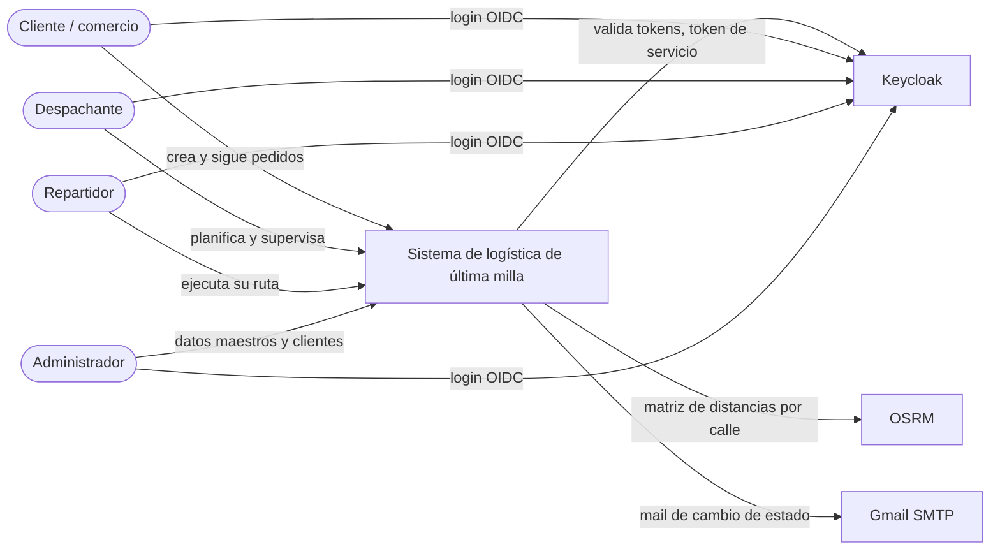
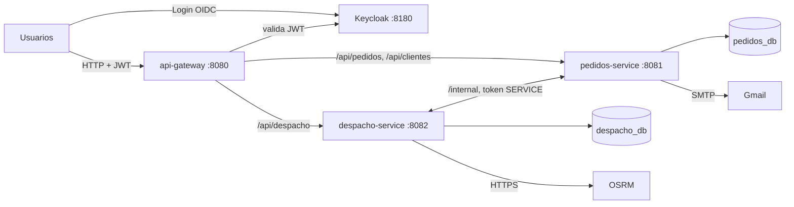
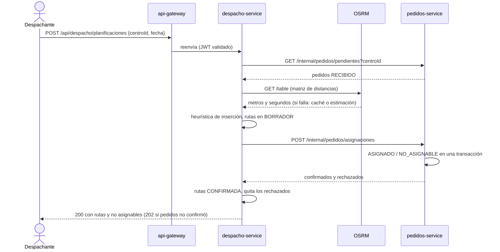
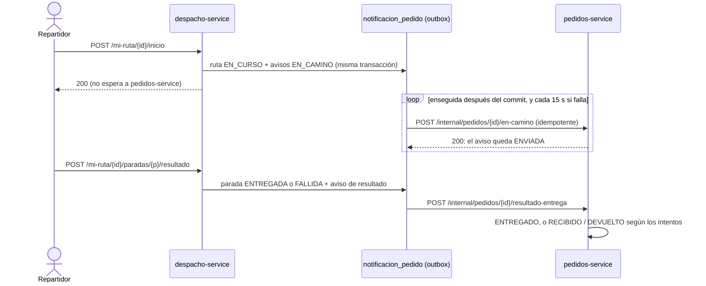

# TPI Logística de última milla

Backend de microservicios para coordinar entregas de última milla: recepción de pedidos, asignación a vehículos y repartidores según restricciones reales, ejecución de rutas y seguimiento. Trabajo Práctico Integrador de **Backend de Aplicaciones 2026** (UTN FRC).

| Integrante | Legajo |
|---|---|
| Schaller, Francisco | 98707 |
| Ibañez, Ignacio | 85593 |
| Rueda, Walter | 407718 |
| Díaz, Lautaro Tobías | 94528 |
| Ludueña, Tomas | 400245 |

**Comisión:** 3K4 · **Docentes:** Federico Bett, Ivo Parun Rua, Franco Pesci

## El problema

Una empresa de logística recibe pedidos de comercios y los reparte desde uno o más centros de distribución con su flota de vehículos y repartidores. Cada día tiene que decidir qué pedidos entregar, con qué vehículo, quién los lleva y en qué orden, sin exceder los recursos: capacidad de carga, autonomía, refrigeración, turno del repartidor, ventana horaria del destinatario y radio de cobertura del centro. Después tiene que seguir lo que pasa en la calle (entregado, fallido, devuelto) y dejar un historial confiable de cada pedido.

## Estructura del repositorio

```
.
├── README.md                 este archivo: visión general, puesta en marcha y estado
├── infra/
│   ├── init-db.sql           crea las bases pedidos_db y despacho_db con sus usuarios
│   └── realm-logistica.json  realm de Keycloak: roles, clients y usuarios de prueba
├── logistica-commons/        JAR Maven compartido por los dos microservicios
├── pedidos-service/          microservicio de pedidos (puerto 8081)
├── despacho-service/         microservicio de operación logística (puerto 8082)
└── api-gateway/              punto de entrada único (puerto 8080)
```

Cada proyecto tiene su propio README con la estructura interna y qué hace cada clase:

- [logistica-commons/README.md](logistica-commons/README.md)
- [pedidos-service/README.md](pedidos-service/README.md)
- [despacho-service/README.md](despacho-service/README.md)
- [api-gateway/README.md](api-gateway/README.md)

Son cuatro proyectos Maven independientes, sin POM padre. `logistica-commons` se instala en el repositorio local (`~/.m2`) y los dos microservicios lo consumen como dependencia normal (`logistica-commons:1.2.0`).

## Arquitectura

### C1: contexto



### C2: contenedores



| Componente | Para qué está |
|---|---|
| `api-gateway` | Único punto de entrada. Enruta por prefijo, valida el JWT (Security Filter) y bloquea `/internal/**`. El cliente no conoce la topología interna. |
| `pedidos-service` | **Gestión del pedido**: perfil del cliente, alta y validación del pedido, ciclo de vida, control de intentos, cancelación e historial de cambios. Es dueño del estado del pedido. |
| `despacho-service` | **Operación logística**: centros, vehículos y repartidores; planificación de rutas; ejecución en la calle; integración con OSRM. Es dueño de las rutas. |
| `logistica-commons` | Lo que es igual en los dos servicios: formato de error, manejo de excepciones, conversión de roles de Keycloak y `Coordenada`. |
| Keycloak | Identity Provider: autentica usuarios (OIDC), emite JWT y administra roles. |
| PostgreSQL | Una instancia con una base por microservicio; ninguno lee la base del otro. |
| OSRM (Open Source Routing Machine) | Distancias y tiempos reales por calle (datos de OpenStreetMap), necesarios para planificar. |
| Gmail SMTP | pedidos-service avisa por mail al cliente cada cambio de estado de su pedido. |

### Por qué dos microservicios y no uno

El dominio tiene dos responsabilidades con datos y ritmos distintos. El **pedido** lo carga el cliente y su historia le interesa al cliente. La **operación** (flota, rutas, ejecución) la maneja la empresa todos los días. Separarlos permite que cada uno guarde solo lo suyo: despacho no guarda los datos personales del destinatario, solo coordenadas, peso y ventana. Además, cada uno sigue funcionando de forma razonable si el otro se cae, como se ve en la tabla siguiente.

### Colaboración entre servicios

Los servicios se hablan solo por `/internal/**`, con un token de client credentials (rol `SERVICE`) que el gateway nunca expone.

| Proceso | Quién inicia | Llamada | Si el otro no responde |
|---|---|---|---|
| Alta de pedido | pedidos | `GET /internal/centros/{id}` (que exista y esté activo) | 503: el pedido no se crea |
| Planificación | despacho | `GET /internal/pedidos/pendientes?centroId` | 503: no se planifica |
| Confirmación | despacho | `POST /internal/pedidos/asignaciones` (ASIGNADO / NO_ASIGNABLE en una sola transacción) | Las rutas quedan en BORRADOR y se reintenta con `POST /api/despacho/planificaciones/confirmacion` |
| Inicio y resultado de ruta | despacho | `POST /internal/pedidos/{id}/en-camino`, `/{id}/resultado-entrega` | **Outbox**: se guardan en `notificacion_pedido` y se reintentan cada 15 s; el repartidor sigue trabajando |
| Cancelación de un ASIGNADO | pedidos | `DELETE /internal/paradas/pedido/{id}` (quita la parada y recalcula la ruta) | 503: no se cancela. Si ya salió a la calle, despacho responde 409 y pedidos devuelve 422 |

La planificación es una pequeña **saga** en dos pasos. Despacho primero persiste las rutas en BORRADOR y después pide a pedidos que confirme. Los pedidos que cambiaron de estado mientras tanto (por ejemplo, porque se cancelaron) vuelven como rechazados, y despacho los quita de la ruta. Los endpoints internos de pedidos son idempotentes porque el outbox puede reenviar un mismo aviso.

**Planificación (saga en dos pasos):**



**Ejecución (outbox):**



### Ciclo de vida del pedido

```
RECIBIDO ──► ASIGNADO ──► EN_CAMINO ──► ENTREGADO
   │  ▲                        │
   │  │                        └──► FALLIDO ──► RECIBIDO (1er intento) / DEVUELTO (2do)
   │  └── reprogramación ──┐
   └──► NO_ASIGNABLE ──────┘

RECIBIDO, ASIGNADO o NO_ASIGNABLE ──► CANCELADO (por el cliente dueño o un despachante)
```

Cada cambio queda registrado con fecha, motivo y autor (`GET /api/pedidos/{id}/cambios`).

### Integración con OSRM

Las distancias y los tiempos reales deciden autonomía, duración de la jornada, ventanas horarias y costo, y dependen de la red vial: no se pueden reemplazar por un dato de configuración. Por eso se obtienen de OSRM (servicio `table`, que devuelve la matriz completa en una consulta), con este orden de respaldo:

1. Caché vigente.
2. OSRM.
3. Caché vencida.
4. Estimación (Haversine × factor de rodeo).

Cuando se usa una estimación, la ruta queda marcada `estimada` para que el despachante la revise.

Por defecto se usa el servidor público de OSRM (`router.project-osrm.org`), que no pide API key ni registro pero limita a una consulta por segundo y no garantiza disponibilidad. Para no depender de él se puede levantar un OSRM propio con el mapa de Argentina (guía de la cátedra, `api-OsrmRoutes.md`) y apuntar `OSRM_URL` a `http://localhost:5000`.

### Seguridad

| Rol | Puede |
|---|---|
| `CLIENTE` | Registrar su perfil, crear pedidos, y consultar o cancelar solo los propios |
| `DESPACHANTE` | Ver todos los pedidos, cancelar, reprogramar, planificar y supervisar rutas y notificaciones |
| `REPARTIDOR` | Ver su ruta del día, iniciarla y registrar el resultado de cada parada |
| `ADMIN` | Gestionar centros, vehículos y repartidores; ver pedidos y clientes, y desactivar clientes |
| `SERVICE` | Cuenta técnica entre microservicios; es el único rol habilitado en `/internal/**` |

La seguridad está en capas:

- **Gateway:** valida el JWT y bloquea `/internal/**`.
- **Cada microservicio:** vuelve a validar el token y aplica los roles (defensa en profundidad).
- **Capa de servicio:** controla las reglas que dependen de datos, como que el cliente solo vea lo suyo y el repartidor solo su ruta.

## Puesta en marcha (local)

Requisitos: JDK 21+, Maven 3.9+, PostgreSQL 17 y Keycloak 26.

1. **Bases de datos** (una sola vez): `psql -U postgres -f infra/init-db.sql`. Las tablas las crea Hibernate al arrancar cada servicio.
2. **Keycloak** en el puerto 8180: copiar `infra/realm-logistica.json` a `<keycloak>/data/import/` y arrancar:
   ```bash
   bin/kc.sh start-dev --http-port=8180 --import-realm      # Windows: bin\kc.bat
   ```
3. **JAR común** (y cada vez que se modifique): `cd logistica-commons && mvn clean install`
4. **Servicios**, cada uno en su terminal o desde IntelliJ: `mvn spring-boot:run` en `pedidos-service`, `despacho-service` y `api-gateway`.

Todas las credenciales y API keys están en los `application.yml` (condición de la cátedra; son cuentas de prueba del TP), así que no hace falta configurar nada para correrlo. Cada valor se puede sobrescribir con una variable de entorno:

| Variable | Uso |
|---|---|
| `OSRM_URL` | Servidor OSRM (por defecto el público). Si no responde o está vacía, las distancias se estiman. |
| `GMAIL_APP_PASSWORD` | Contraseña de aplicación de Google (16 caracteres) de la cuenta que manda los mails. Si está vacía no se envían mails. |
| `GMAIL_USER` | Cuenta de Gmail remitente (por defecto `ultimamilla.tpbackend@gmail.com`) |
| `SERVICE_CLIENT_SECRET` | Secret del client `logistica-service` |
| `PEDIDOS_DB_*`, `DESPACHO_DB_*` | Host, puerto, nombre, usuario y contraseña de cada base |
| `KEYCLOAK_ISSUER_URI`, `KEYCLOAK_JWK_SET_URI`, `KEYCLOAK_TOKEN_URI` | URLs de Keycloak |
| `PEDIDOS_SERVICE_URL`, `DESPACHO_SERVICE_URL` | URLs de los servicios |

Para sobrescribir un valor sin tocar el archivo, elegí una:

- **IntelliJ:** en la Run Configuration del servicio, en Environment variables.
- **PowerShell, solo esa terminal:** `$env:OSRM_URL = "http://localhost:5000"`
- **Variable de usuario de Windows, permanente:** `setx OSRM_URL "http://localhost:5000"`

## Cómo probarlo

La carpeta `postman/` tiene todo lo necesario:

| Archivo | Para qué |
|---|---|
| `TPI-Logistica.postman_collection.json` | Colección ejecutable: 53 requests en orden, cada una con sus `pm.test` |
| `Local.postman_environment.json` | Entorno con las URLs, la fecha, los tokens y los ids que se van encadenando |
| `Guia-pruebas-Postman.pdf` | Guía paso a paso: arranque, ejecución y escenarios que se prueban a mano |

Con los servicios levantados, se corre completa desde Postman (Import de los dos archivos, entorno **Local**, Collection Runner) o desde la consola:

```bash
postman collection run postman/TPI-Logistica.postman_collection.json -e postman/Local.postman_environment.json
```

Resultado esperado: 53 requests y 91 verificaciones sin fallas. Las carpetas siguen el proceso: `0. Auth` → `1. Datos maestros` → `2. Cliente` → `3. Planificación` → `4. Ejecución` → `5. Seguimiento` → `6. Negativos y seguridad`.

**Para repetirla el mismo día** hay que volver los datos al estado inicial, porque un vehículo y un repartidor hacen una sola ruta por día (RN11):

```bash
psql -U postgres -f infra/reset-datos.sql
```

Usuarios de prueba (la contraseña es igual al usuario): `cliente1`, `despachante1`, `repartidor1`, `repartidor2`, `repartidor3`, `admin1`.

Documentación OpenAPI: http://localhost:8081/swagger-ui.html y http://localhost:8082/swagger-ui.html.

Tests automáticos: `mvn test` en `logistica-commons`, `pedidos-service` y `despacho-service` (92 tests).

## Trazabilidad: compromiso → implementación → evidencia

Los códigos F, RN, P, N y V son los del acuerdo-compromiso. "Colección" se refiere a los escenarios de `postman/TPI-Logistica.postman_collection.json`.

### Funcionalidades

| ID | Funcionalidad | Implementación | Evidencia |
|---|---|---|---|
| F01 | Registrar perfil de cliente | `ClienteController`, `ClienteService` | `ClienteServiceTest`; colección P1 |
| F02 | Crear pedido | `PedidoController`, `PedidoService.crear` | `PedidoServiceTest`; colección P1, N1, N2 |
| F03 | Consultar pedidos e historial | `PedidoService.listar`, `obtener`, `historial` | Colección P8 y "Mis pedidos" |
| F04 | Cancelar pedido | `Pedido.cancelar`, `PedidoService.cancelar`, `CancelacionService` (despacho) | `PedidoServiceTest.cancelarAsignadoQuitaDeLaRuta`; colección P7, N4 |
| F05 | Datos maestros | `CentroController`, `VehiculoController`, `RepartidorController` | Colección carpeta 1; `DespachoSecurityTest` |
| F06 | Planificar rutas del día | `PlanificacionService`, `PlanificadorRutas`, `CalculadoraRuta` | `PlanificadorRutasTest` (11); colección P2 |
| F07 | Reintentar confirmación o descartar borrador | `POST /planificaciones/confirmacion`, `DELETE /rutas/{id}` | Manual (ver abajo) |
| F08 | Reprogramar no asignable | `Pedido.reprogramar` | `PedidoServiceTest.reprogramar`; colección P6, N5 |
| F09 | Consultar e iniciar mi ruta | `MiRutaController`, `EjecucionRutaService.iniciar` | Colección P3, N7 |
| F10 | Resultado de parada | `EjecucionRutaService`, `Pedido.registrarFallo` | `PedidoTest`; colección P4, P5, N8 |
| F11 | Supervisar rutas y notificaciones | `RutaController`, `NotificacionController` | Colección carpetas 3 y 5 |
| F12 | Distancias reales | `DistanciaService`, `OsrmClient` | `DistanciaServiceTest` (5), `OsrmClientTest` (3); colección P9 |
| F13 | Autenticación y autorización | Gateway y `SecurityConfig` de cada servicio | `PedidoControllerSecurityTest`, `DespachoSecurityTest`; colección N10, N11, N12 |
| F14 | Gestionar clientes | `ClienteController`, `Cliente.desactivar` | `ClienteServiceTest.desactivar`, `PedidoServiceTest.crearConClienteInactivo` |

### Reglas de negocio

| ID | Regla | Implementación | Evidencia |
|---|---|---|---|
| RN01 | Perfil existente y activo para crear pedidos | `PedidoService.crear` | `PedidoServiceTest.crearSinPerfil`, `crearConClienteInactivo` |
| RN02 | Ventana válida; peso y volumen positivos | `Pedido.ventanaValida`, Bean Validation | `PedidoTest.ventanaValida`; colección N1 y "peso negativo" |
| RN03 | Centro existente y activo (consulta a despacho) | `PedidoService.crear`, `DespachoClient` | `PedidoServiceTest.crearConCentroInexistente`, `crearConCentroInactivo`, `crearConDespachoCaido`; colección N2 |
| RN04 | El cliente solo ve y opera lo suyo | `Pedido.perteneceA`, `PedidoService.buscarConAcceso` | `PedidoControllerSecurityTest.clienteNoVePedidoAjeno`, `PedidoServiceTest.cancelarPedidoAjeno` |
| RN05 | Solo transiciones válidas, con historial | `Pedido.cambiarEstado` (`TRANSICIONES`) | `PedidoTest.transicionValida`, `transicionInvalida`; colección P8 |
| RN06 | Cancelación solo antes de salir a la calle | `Pedido.cancelar`, `CancelacionService` | `PedidoTest.fueraDeEstado`; colección P7, N4 |
| RN07 | URGENTE primero, después la ventana más ajustada | `PlanificadorRutas.ORDEN_DE_ATENCION` | `PlanificadorRutasTest.urgenteTienePrioridadCuandoNoHayCapacidadParaAmbos` |
| RN08 | Capacidad, frío, ventana, turno, autonomía y cobertura a la vez | `CalculadoraRuta` | `PlanificadorRutasTest` (frío, ventanas, turno, cobertura); colección P2 |
| RN09 | Menor costo; abrir otra ruta si conviene | `PlanificadorRutas` | `PlanificadorRutasTest.agrupaPedidosCercanosEnUnaSolaRutaConElVehiculoMasBarato`, `abreOtraRutaCuandoLaPrimeraSeLlena` |
| RN10 | Sin ruta factible: NO_ASIGNABLE con motivo | `PlanificadorRutas`, `MotivoNoAsignable` | `PlanificadorRutasTest.destinoFueraDeCoberturaNoEsAsignable`; colección P2, P6 |
| RN11 | Un vehículo y un repartidor hacen una ruta por día | `PlanificadorRutas` y restricciones únicas | `PlanificadorRutasTest.sinRecursosLibresTodosQuedanNoAsignables` |
| RN12 | Sin fechas pasadas ni planificaciones simultáneas | `PlanificacionService` | Colección N6 |
| RN13 | Saga: BORRADOR y confirmación en una transacción | `PlanificacionService`, `PedidoService.confirmarAsignacion` | `PedidoServiceTest.confirmarAsignacion`; colección P2 |
| RN14 | Inicio solo por el repartidor asignado, con la ruta CONFIRMADA y no futura | `EjecucionRutaService.iniciar` | Colección P3, N7 |
| RN15 | Resultado con ruta EN_CURSO y parada PENDIENTE; motivo si falla | `EjecucionRutaService`, `ResultadoParadaRequest` | Colección P4, P5, N8 |
| RN16 | 1er fallo → RECIBIDO; 2do → DEVUELTO | `Pedido.registrarFallo` | `PedidoTest.primerIntento`, `segundoIntento`; colección P5 |
| RN17 | Outbox con reintentos; endpoints internos idempotentes | `NotificacionPedidoService`, `PedidoService.registrarSalida` y `registrarResultado` | `PedidoServiceTest.resultadoFallidoIdempotente`; colección P3; V7 manual |
| RN18 | Caché vigente → OSRM → caché vencida → estimación | `DistanciaService` | `DistanciaServiceTest` (5); colección P9 |
| RN19 | Reprogramar solo un NO_ASIGNABLE | `Pedido.reprogramar` | `PedidoServiceTest.reprogramar`; colección P6, N5 |
| RN20 | `/internal/**` solo SERVICE; el gateway lo bloquea | `SecurityConfig` de los tres proyectos | `PedidoControllerSecurityTest`, `DespachoSecurityTest`; colección N12 |

### Escenarios que se prueban a mano

Requieren detener un servicio a mitad de camino, así que no están en la colección. Los pasos están en la guía PDF.

| ID | Escenario | Cómo |
|---|---|---|
| N3 | Alta con despacho-service caído → 503 | Detener despacho-service y crear un pedido |
| V7 | Tolerancia a caídas (outbox) | Detener pedidos-service con una ruta EN_CURSO, registrar una parada y volver a levantarlo |
| F07 | Rutas en BORRADOR y reintento de confirmación | Detener pedidos-service después de que despacho lea los pendientes y reintentar con `POST /planificaciones/confirmacion` |

## Desvíos respecto del compromiso

| Qué cambió | Motivo | Impacto |
|---|---|---|
| Google Maps Distance Matrix → **OSRM** | Google exige activar facturación con tarjeta incluso para la cuota gratuita. OSRM es la alternativa propuesta por la cátedra (`api-OsrmRoutes.md`): datos de OpenStreetMap y sin API key. | F12, RN18, V8 y P9: la fuente `GOOGLE` pasa a llamarse `OSRM`. Caché, estimación de respaldo y planificación no cambian. |
| **Mails** al cliente en cada cambio de estado | Agregado. Va al email del comercio (el cliente), no al destinatario, que sigue fuera del alcance. | pedidos-service: `CambioEstadoListener` y `NotificadorMail`. Si Gmail falla, el pedido no se ve afectado. |
| Credenciales en los `application.yml` | Condición de la cátedra. El compromiso decía variables de entorno y un `.env` sin versionar. | Cada valor se sigue pudiendo sobrescribir con su variable de entorno. |
| P2: "el urgente queda primero" | RN07 define el orden de **atención**: el urgente toma la capacidad antes que los demás, pero su posición en la ruta la deciden el costo y su ventana. | La colección verifica la asignación del urgente, no el orden de las paradas. |
| V4: segundo fallo en la misma demo | Por RN11 (una ruta por recurso y día) no queda un repartidor libre para replanificar ese mismo día. | Se verifica con `PedidoTest.segundoIntento`; en vivo, al día siguiente. |
| N9: pedido de otro cliente | El realm tiene un solo usuario con rol CLIENTE. | Se verifica con `PedidoControllerSecurityTest.clienteNoVePedidoAjeno`. |

## Estado del proyecto

| Requisito del enunciado | Estado |
|---|---|
| ≥ 2 microservicios con responsabilidades del dominio | ✅ pedidos-service y despacho-service |
| Colaboración real entre servicios y manejo de caídas | ✅ Alta, planificación (saga), ejecución (outbox) y cancelación |
| API Gateway con Security Filter | ✅ Enrutamiento, validación de JWT y bloqueo de `/internal/**` |
| API pública externa necesaria para el negocio | ✅ OSRM (distancias por calle), con caché y estimación de respaldo |
| Keycloak, OIDC, JWT, Spring Security y roles | ✅ 4 roles humanos y 1 técnico; client credentials entre servicios |
| Componente común en JAR Maven | ✅ `logistica-commons` 1.2.0, instalado en `.m2` |
| Persistencia en DBMS relacional | ✅ PostgreSQL, una base por servicio |
| APIs REST validadas y documentadas con OpenAPI | ✅ Bean Validation, códigos HTTP coherentes y Swagger UI |
| Contenerización y Docker Compose | ⏸️ **Pendiente a propósito.** Se quitó por ahora; las dependencias Maven se mantienen. |
| Diagramas C4 (C1 y C2) y de secuencia | ✅ En este README, actualizados a la arquitectura implementada |

Además:

- **Probado:** 92 tests unitarios, de integración y de seguridad en verde, y la colección completa de punta a punta (53 requests, 91 verificaciones) con Postgres, Keycloak y los tres servicios levantados.
