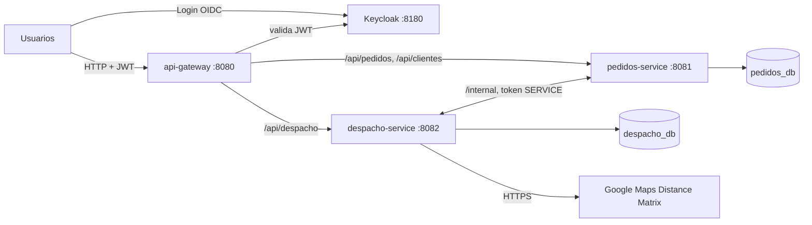

# TPI Logística de última milla

Backend de microservicios para coordinar entregas de última milla: recepción de pedidos, asignación a vehículos y repartidores según restricciones reales, ejecución de rutas y seguimiento. Trabajo Práctico Integrador de **Backend de Aplicaciones 2026** (UTN FRC).

| Integrante | Legajo |
|---|---|
| Schaller, Francisco | 98707 |
| Ibañez, Ignacio | 85593 |
| Rueda, Walter | 407718 |
| Díaz, Lautaro Tobías | 94528 |

**Comisión:** 3K4 · **Docentes:** Federico Bett, Ivo Parun Rua, Franco Pesci

## El problema

Una empresa de logística recibe pedidos de comercios y los reparte desde uno o más centros de distribución con su flota de vehículos y repartidores. Cada día tiene que decidir qué pedidos entregar, con qué vehículo, quién los lleva y en qué orden, sin exceder los recursos: capacidad de carga, autonomía, refrigeración, turno del repartidor, ventana horaria del destinatario y radio de cobertura del centro. Después tiene que seguir lo que pasa en la calle (entregado, fallido, devuelto) y dejar un historial confiable de cada pedido.

## Estructura del repositorio

```
.
├── README.md                 este archivo: visión general, puesta en marcha y estado
├── infra/
│   ├── init-db.sql           crea las bases pedidos_db y despacho_db con sus usuarios
│   └── realm-logistica.json  realm de Keycloak: roles, clients y usuarios de prueba
├── logistica-commons/        JAR Maven compartido por los dos microservicios
├── pedidos-service/          microservicio de pedidos (puerto 8081)
├── despacho-service/         microservicio de operación logística (puerto 8082)
└── api-gateway/              punto de entrada único (puerto 8080)
```

Cada proyecto tiene su propio README con la estructura interna y qué hace cada clase:

- [logistica-commons/README.md](logistica-commons/README.md)
- [pedidos-service/README.md](pedidos-service/README.md)
- [despacho-service/README.md](despacho-service/README.md)
- [api-gateway/README.md](api-gateway/README.md)

Son cuatro proyectos Maven independientes, sin POM padre. `logistica-commons` se instala en el repositorio local (`~/.m2`) y los dos microservicios lo consumen como dependencia normal (`logistica-commons:1.2.0`).

## Arquitectura



| Componente | Para qué está |
|---|---|
| `api-gateway` | Único punto de entrada. Enruta por prefijo, valida el JWT (Security Filter) y bloquea `/internal/**`. El cliente no conoce la topología interna. |
| `pedidos-service` | **Gestión del pedido**: perfil del cliente, alta y validación del pedido, ciclo de vida, control de intentos, cancelación e historial de cambios. Es dueño del estado del pedido. |
| `despacho-service` | **Operación logística**: centros, vehículos y repartidores; planificación de rutas; ejecución en la calle; integración con Google Maps. Es dueño de las rutas. |
| `logistica-commons` | Lo que es igual en los dos servicios: formato de error, manejo de excepciones, conversión de roles de Keycloak y `Coordenada`. |
| Keycloak | Identity Provider: autentica usuarios (OIDC), emite JWT y administra roles. |
| PostgreSQL | Una instancia con una base por microservicio; ninguno lee la base del otro. |
| Google Maps Distance Matrix | Distancias y tiempos reales por calle, necesarios para planificar. |

### Por qué dos microservicios y no uno

El dominio tiene dos responsabilidades con datos y ritmos distintos. El **pedido** lo carga el cliente y su historia le interesa al cliente. La **operación** (flota, rutas, ejecución) la maneja la empresa todos los días. Separarlos permite que cada uno guarde solo lo suyo: despacho no guarda los datos personales del destinatario, solo coordenadas, peso y ventana. Además, cada uno sigue funcionando de forma razonable si el otro se cae, como se ve en la tabla siguiente.

### Colaboración entre servicios

Los servicios se hablan solo por `/internal/**`, con un token de client credentials (rol `SERVICE`) que el gateway nunca expone.

| Proceso | Quién inicia | Llamada | Si el otro no responde |
|---|---|---|---|
| Alta de pedido | pedidos | `GET /internal/centros/{id}` (que exista y esté activo) | 503: el pedido no se crea |
| Planificación | despacho | `GET /internal/pedidos/pendientes?centroId` | 503: no se planifica |
| Confirmación | despacho | `POST /internal/pedidos/asignaciones` (ASIGNADO / NO_ASIGNABLE en una sola transacción) | Las rutas quedan en BORRADOR y se reintenta con `POST /api/despacho/planificaciones/confirmacion` |
| Inicio y resultado de ruta | despacho | `POST /internal/pedidos/{id}/en-camino`, `/{id}/resultado-entrega` | **Outbox**: se guardan en `notificacion_pedido` y se reintentan cada 15 s; el repartidor sigue trabajando |
| Cancelación de un ASIGNADO | pedidos | `DELETE /internal/paradas/pedido/{id}` (quita la parada y recalcula la ruta) | 503: no se cancela. Si ya salió a la calle, despacho responde 409 y pedidos devuelve 422 |

La planificación es una pequeña **saga** en dos pasos. Despacho primero persiste las rutas en BORRADOR y después pide a pedidos que confirme. Los pedidos que cambiaron de estado mientras tanto (por ejemplo, porque se cancelaron) vuelven como rechazados, y despacho los quita de la ruta. Los endpoints internos de pedidos son idempotentes porque el outbox puede reenviar un mismo aviso.

### Ciclo de vida del pedido

```
RECIBIDO ──► ASIGNADO ──► EN_CAMINO ──► ENTREGADO
   │  ▲                        │
   │  │                        └──► FALLIDO ──► RECIBIDO (1er intento) / DEVUELTO (2do)
   │  └── reprogramación ──┐
   └──► NO_ASIGNABLE ──────┘

RECIBIDO, ASIGNADO o NO_ASIGNABLE ──► CANCELADO (por el cliente dueño o un despachante)
```

Cada cambio queda registrado con fecha, motivo y autor (`GET /api/pedidos/{id}/cambios`).

### Integración con Google Maps

Las distancias y los tiempos reales deciden autonomía, duración de la jornada, ventanas horarias y costo, y dependen de la red vial: no se pueden reemplazar por un dato de configuración. Por eso se obtienen de Distance Matrix, con este orden de respaldo:

1. Caché vigente.
2. Google.
3. Caché vencida.
4. Estimación (Haversine × factor de rodeo).

Cuando se usa una estimación, la ruta queda marcada `estimada` para que el despachante la revise.

### Seguridad

| Rol | Puede |
|---|---|
| `CLIENTE` | Registrar su perfil, crear pedidos, y consultar o cancelar solo los propios |
| `DESPACHANTE` | Ver todos los pedidos, cancelar, reprogramar, planificar y supervisar rutas y notificaciones |
| `REPARTIDOR` | Ver su ruta del día, iniciarla y registrar el resultado de cada parada |
| `ADMIN` | Gestionar centros, vehículos y repartidores; ver pedidos y clientes, y desactivar clientes |
| `SERVICE` | Cuenta técnica entre microservicios; es el único rol habilitado en `/internal/**` |

La seguridad está en capas:

- **Gateway:** valida el JWT y bloquea `/internal/**`.
- **Cada microservicio:** vuelve a validar el token y aplica los roles (defensa en profundidad).
- **Capa de servicio:** controla las reglas que dependen de datos, como que el cliente solo vea lo suyo y el repartidor solo su ruta.

## Puesta en marcha (local)

Requisitos: JDK 21+, Maven 3.9+, PostgreSQL 17 y Keycloak 26.

1. **Bases de datos** (una sola vez): `psql -U postgres -f infra/init-db.sql`. Las tablas las crea Hibernate al arrancar cada servicio.
2. **Keycloak** en el puerto 8180: copiar `infra/realm-logistica.json` a `<keycloak>/data/import/` y arrancar:
   ```bash
   bin/kc.sh start-dev --http-port=8180 --import-realm      # Windows: bin\kc.bat
   ```
3. **JAR común** (y cada vez que se modifique): `cd logistica-commons && mvn clean install`
4. **Servicios**, cada uno en su terminal o desde IntelliJ: `mvn spring-boot:run` en `pedidos-service`, `despacho-service` y `api-gateway`.

Los valores por defecto de los `application.yml` apuntan a `localhost` y a las credenciales de desarrollo de `infra/`. Se sobrescriben con variables de entorno:

| Variable | Uso |
|---|---|
| `GOOGLE_MAPS_API_KEY` | API key de Distance Matrix. **Nunca va en un archivo del repo.** Sin ella, las distancias se estiman. |
| `SERVICE_CLIENT_SECRET` | Secret del client `logistica-service` |
| `PEDIDOS_DB_*`, `DESPACHO_DB_*` | Host, puerto, nombre, usuario y contraseña de cada base |
| `KEYCLOAK_ISSUER_URI`, `KEYCLOAK_JWK_SET_URI`, `KEYCLOAK_TOKEN_URI` | URLs de Keycloak |
| `PEDIDOS_SERVICE_URL`, `DESPACHO_SERVICE_URL` | URLs de los servicios |

Para cargar la API key, elegí una:

- **IntelliJ:** en la Run Configuration de `DespachoServiceApplication`, en Environment variables.
- **PowerShell, solo esa terminal:** `$env:GOOGLE_MAPS_API_KEY = "..."`
- **Variable de usuario de Windows, permanente:** `setx GOOGLE_MAPS_API_KEY "..."`

## Cómo probarlo

Todo va contra el gateway (`http://localhost:8080`) con `Authorization: Bearer <token>`. En Postman se pide el token en Authorization → OAuth 2.0 → Password Credentials:

- Token URL: `http://localhost:8180/realms/logistica/protocol/openid-connect/token`
- Client ID: `logistica-public`

Usuarios de prueba (la contraseña es igual al usuario): `cliente1`, `despachante1`, `repartidor1`, `repartidor2`, `repartidor3`, `admin1`.

Flujo completo:

1. `cliente1`: `POST /api/clientes/me` registra su perfil.
2. `cliente1`: `POST /api/pedidos` crea un pedido (centro 1, ventana de hoy).
3. `despachante1`: `POST /api/despacho/planificaciones` con `{ "centroId": 1, "fecha": "<hoy>" }`.
4. `repartidor1`: `GET /api/despacho/mi-ruta`, después `POST /api/despacho/mi-ruta/{rutaId}/inicio`.
5. `repartidor1`: `POST /api/despacho/mi-ruta/{rutaId}/paradas/{paradaId}/resultado` con `{ "resultado": "ENTREGADA" }`.
6. `cliente1`: `GET /api/pedidos/{id}/cambios` muestra el historial completo.

Documentación OpenAPI: http://localhost:8081/swagger-ui.html y http://localhost:8082/swagger-ui.html.

Tests automáticos: `mvn test` en `logistica-commons`, `pedidos-service` y `despacho-service` (60 tests).

## Estado del proyecto

| Requisito del enunciado | Estado |
|---|---|
| ≥ 2 microservicios con responsabilidades del dominio | ✅ pedidos-service y despacho-service |
| Colaboración real entre servicios y manejo de caídas | ✅ Alta, planificación (saga), ejecución (outbox) y cancelación |
| API Gateway con Security Filter | ✅ Enrutamiento, validación de JWT y bloqueo de `/internal/**` |
| API pública externa necesaria para el negocio | ✅ Google Distance Matrix, con caché y estimación de respaldo |
| Keycloak, OIDC, JWT, Spring Security y roles | ✅ 4 roles humanos y 1 técnico; client credentials entre servicios |
| Componente común en JAR Maven | ✅ `logistica-commons` 1.2.0, instalado en `.m2` |
| Persistencia en DBMS relacional | ✅ PostgreSQL, una base por servicio |
| APIs REST validadas y documentadas con OpenAPI | ✅ Bean Validation, códigos HTTP coherentes y Swagger UI |
| Contenerización y Docker Compose | ⏸️ **Pendiente a propósito.** Se quitó por ahora; las dependencias Maven se mantienen. |
| Diagramas C4 (C1 y C2) | ⚠️ Están en el documento de dominio del equipo; falta actualizarlos a la arquitectura implementada (dos bases, outbox) y agregarlos al repo |

Además:

- **Probado:** compilación y 60 tests unitarios y de seguridad en verde.
- **Falta:** una prueba de punta a punta con Postgres, Keycloak y los tres servicios levantados.
