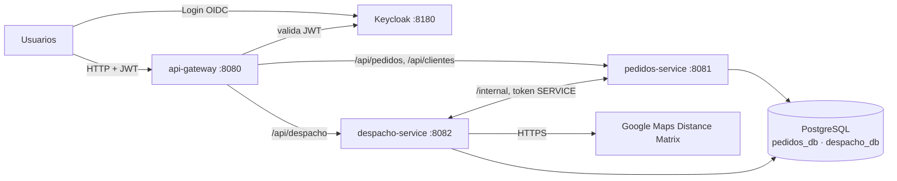

# TPI Logística de última milla

Backend de microservicios para coordinar entregas de última milla: recepción de pedidos, asignación a vehículos y repartidores según restricciones reales, ejecución de rutas y seguimiento. Trabajo Práctico Integrador de **Backend de Aplicaciones 2026** (UTN FRC).

## Equipo

| Integrante | Legajo |
|---|---|
| Schaller, Francisco | 98707 |
| Ibañez, Ignacio | 85593 |
| Rueda, Walter | 407718 |
| Díaz, Lautaro Tobías | 94528 |

**Comisión:** 3K4 · **Docentes:** Federico Bett, Ivo Parun Rua, Franco Pesci

## Arquitectura



| Proyecto | Responsabilidad |
|---|---|
| `api-gateway` | Punto de entrada. Enruta, valida el JWT (Security Filter) y bloquea `/internal/**` |
| `pedidos-service` | Clientes, alta y validación del pedido, ciclo de vida, intentos, cancelación e historial |
| `despacho-service` | Centros, vehículos y repartidores; planificación de rutas; ejecución; Google Maps |
| `logistica-commons` | JAR Maven compartido: `ApiError`, `GlobalExceptionHandler`, `KeycloakRoleConverter`, `Coordenada` |

Son cuatro proyectos Maven independientes, sin POM padre. `logistica-commons` se instala en el repositorio local (`~/.m2`) y los dos microservicios lo consumen como dependencia (`logistica-commons:1.2.0`). El gateway no lo usa porque es reactivo (WebFlux) y el JAR asume Spring MVC.

Cada servicio tiene su propia base (`pedidos_db`, `despacho_db`) en la misma instancia de PostgreSQL y nunca lee la del otro.

## Ciclo de vida del pedido

```
RECIBIDO ──► ASIGNADO ──► EN_CAMINO ──► ENTREGADO
   │  ▲          │             │
   │  │          │             └──► FALLIDO ──► RECIBIDO (1er intento) / DEVUELTO (2do)
   │  └── reprogramación ──┐   │
   └──► NO_ASIGNABLE ──────┘   │
RECIBIDO, ASIGNADO, NO_ASIGNABLE ──► CANCELADO (cliente dueño o despachante)
```

Cada cambio queda registrado con fecha, motivo y autor (`GET /api/pedidos/{id}/cambios`).

## Colaboración entre servicios

`pedidos-service` es dueño del estado del pedido; `despacho-service` es dueño de las rutas. Se comunican solo por `/internal/**`, con un token de client credentials (rol `SERVICE`) que el gateway nunca expone.

| Proceso | Quién inicia | Llamada | Si el otro no responde |
|---|---|---|---|
| Alta de pedido | pedidos | `GET /internal/centros/{id}` (existe y activo) | 503, el pedido no se crea |
| Planificación | despacho | `GET /internal/pedidos/pendientes?centroId` | 503, no se planifica |
| Confirmación | despacho | `POST /internal/pedidos/asignaciones` (ASIGNADO / NO_ASIGNABLE en una transacción) | Las rutas quedan en BORRADOR; se reintenta con `POST /api/despacho/planificaciones/confirmacion` |
| Inicio y resultado de ruta | despacho | `POST /internal/pedidos/{id}/en-camino`, `/{id}/resultado-entrega` | Outbox: se guardan en `notificacion_pedido` y se reintentan cada 15 s; el repartidor sigue trabajando |
| Cancelación de un ASIGNADO | pedidos | `DELETE /internal/paradas/pedido/{id}` (quita la parada y recalcula) | 503, no se cancela; 409 de despacho → 422 "ya salió a la calle" |

Los endpoints internos de pedidos son idempotentes porque el outbox puede reenviar.

## Integración con Google Maps

`despacho-service` usa Distance Matrix para obtener km y minutos reales entre el centro y cada destino, necesarios para autonomía, jornada, ventanas horarias y costo. Si Google no responde, rechaza la consulta o no encuentra ruta: se usa la caché (`distancia_cache`, aunque esté vencida) y, en último caso, una estimación Haversine × factor de rodeo, marcando la ruta como `estimada` para que el despachante la revise. Sin `GOOGLE_MAPS_API_KEY` se trabaja solo con caché y estimación.

## Seguridad

| Rol | Puede |
|---|---|
| `CLIENTE` | Registrar su perfil, crear pedidos y consultar/cancelar solo los propios |
| `DESPACHANTE` | Ver todos los pedidos, cancelar, reprogramar, planificar y supervisar rutas y notificaciones |
| `REPARTIDOR` | Ver su ruta del día, iniciarla y registrar el resultado de cada parada |
| `ADMIN` | Gestionar centros, vehículos y repartidores; ver pedidos y clientes, desactivar clientes |
| `SERVICE` | Cuenta técnica entre microservicios; único rol habilitado en `/internal/**` |

El gateway valida el JWT y bloquea `/internal/**`. Cada microservicio vuelve a validar el token y aplica los roles (`KeycloakRoleConverter` de commons). Las reglas que dependen de datos (el cliente solo ve lo suyo, el repartidor solo su ruta) se controlan en la capa de servicio.

## Puesta en marcha (local)

Requisitos: JDK 21+, Maven 3.9+, PostgreSQL 17 y Keycloak 26.

1. **Bases de datos** (una sola vez):

   ```bash
   psql -U postgres -f infra/init-db.sql
   ```

2. **Keycloak** en el puerto 8180, importando el realm. Antes de arrancar, copiar `infra/realm-logistica.json` a `<keycloak>/data/import/`:

   ```bash
   bin/kc.sh start-dev --http-port=8180 --import-realm      # Windows: bin\kc.bat
   ```

3. **JAR común** (y cada vez que se modifique):

   ```bash
   cd logistica-commons && mvn clean install
   ```

4. **Servicios**, cada uno en su terminal (o desde IntelliJ):

   ```bash
   cd pedidos-service  && mvn spring-boot:run
   cd despacho-service && mvn spring-boot:run
   cd api-gateway      && mvn spring-boot:run
   ```

Todos los valores por defecto de los `application.yml` apuntan a `localhost` y a las credenciales de desarrollo de `infra/`. Se pueden sobrescribir con variables de entorno:

| Variable | Uso |
|---|---|
| `GOOGLE_MAPS_API_KEY` | API key de Distance Matrix (no commitearla) |
| `SERVICE_CLIENT_SECRET` | Secret del client `logistica-service` |
| `PEDIDOS_DB_*`, `DESPACHO_DB_*` | Host, puerto, nombre, usuario y contraseña de cada base |
| `KEYCLOAK_ISSUER_URI`, `KEYCLOAK_JWK_SET_URI`, `KEYCLOAK_TOKEN_URI` | URLs de Keycloak |
| `PEDIDOS_SERVICE_URL`, `DESPACHO_SERVICE_URL` | URLs de los servicios |

`despacho-service` carga datos semilla al arrancar (`data.sql`): dos centros, cuatro vehículos y tres repartidores, cuyos ids coinciden con los usuarios `repartidor1..3` del realm.

## Probar la API

Usuarios de prueba (la contraseña es igual al usuario): `cliente1`, `despachante1`, `repartidor1`, `repartidor2`, `repartidor3`, `admin1`.

```bash
TOKEN=$(curl -s -X POST http://localhost:8180/realms/logistica/protocol/openid-connect/token \
  -d client_id=logistica-public -d grant_type=password \
  -d username=cliente1 -d password=cliente1 | jq -r .access_token)

curl -X POST http://localhost:8080/api/clientes/me -H "Authorization: Bearer $TOKEN" \
  -H "Content-Type: application/json" \
  -d '{"razonSocial":"Comercio Sur","cuit":"30-11111111-9","email":"sur@test.com"}'
```

Flujo completo: el cliente registra su perfil y crea pedidos (`POST /api/pedidos`); el despachante planifica (`POST /api/despacho/planificaciones` con `centroId` y `fecha`); el repartidor consulta `GET /api/despacho/mi-ruta`, la inicia y registra cada parada; el cliente sigue el historial en `GET /api/pedidos/{id}/cambios`.

Documentación OpenAPI de cada servicio: `http://localhost:8081/swagger-ui.html` y `http://localhost:8082/swagger-ui.html`.

## Tests

```bash
cd logistica-commons && mvn test   # Coordenada
cd pedidos-service   && mvn test   # modelo Pedido, servicios y seguridad
cd despacho-service  && mvn test   # planificador de rutas
```
