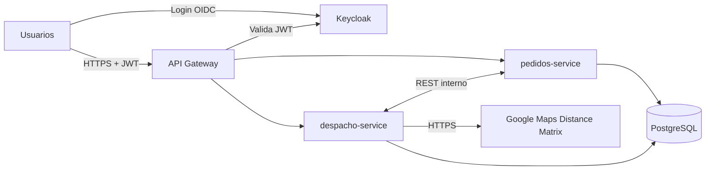

# TPI Backend - Logistica de entregas de ultima milla

Sistema de microservicios para gestion de pedidos y despacho de entregas de
ultima milla.

- **Java 21**, **Spring Boot 3.5.16**, **Maven**, **PostgreSQL 17**, **Keycloak 26**, **Docker Compose**
- Package base / groupId: `utnfc.isi.back.logistica`

## Proyectos

Son **cuatro proyectos Maven independientes**: no hay POM padre ni reactor.
Cada uno tiene su propio `pom.xml` y se construye por separado.

| Proyecto | Artifact | Puerto | Descripcion |
|---|---|---|---|
| `logistica-commons` | `logistica-commons:1.0.0` | - | JAR comun (errores, roles, enums, Coordenada) |
| `api-gateway` | `api-gateway:1.0.0` | 8080 | Spring Cloud Gateway (WebFlux) + validacion de JWT |
| `pedidos-service` | `pedidos-service:1.0.0` | 8081 | Pedidos (Spring MVC + JPA) |
| `despacho-service` | `despacho-service:1.0.0` | 8082 | Despacho/envios + Google Distance Matrix |

`logistica-commons` se consume como dependencia normal por
`groupId:artifactId:version`, asi que **hay que instalarlo en el repositorio
local (`~/.m2`) antes de compilar los servicios**.

El gateway **no** usa `logistica-commons`: es reactivo (WebFlux) y el JAR comun
asume Spring MVC.

## Orden de build (local)

```bash
# 1. Primero el JAR comun -> queda en ~/.m2
cd logistica-commons && mvn clean install

# 2. Despues, en cualquier orden
cd ../pedidos-service  && mvn clean package
cd ../despacho-service && mvn clean package
cd ../api-gateway      && mvn clean package
```

Si se saltea el paso 1, los servicios fallan con
`Could not resolve dependencies ... logistica-commons:jar:1.0.0`.

## Levantar todo con Docker

```bash
cp .env.example .env     # y completar GOOGLE_MAPS_API_KEY
docker compose up --build
```

No hace falta compilar nada a mano: los `Dockerfile` de `pedidos-service` y
`despacho-service` son multi-stage, se construyen con contexto en la raiz del
repo y hacen `mvn clean install` de `logistica-commons` dentro de la imagen de
build antes de empaquetar el servicio.

Puertos publicados al host (lo demas queda en la red interna de Docker):

| Servicio | URL |
|---|---|
| API Gateway | http://localhost:8080 |
| Keycloak | http://localhost:8180 (admin/admin por defecto) |

Swagger UI de cada servicio (solo accesible desde dentro de la red de Docker o
levantando el servicio localmente): `http://localhost:8081/swagger-ui.html` y
`http://localhost:8082/swagger-ui.html`.

## Seguridad

Keycloak importa el realm `logistica` desde `infra/realm-logistica.json`:

- Roles: `CLIENTE`, `DESPACHANTE`, `REPARTIDOR`, `ADMIN`, `SERVICE`
- Client publico `logistica-public` (password grant, para pruebas)
- Client confidencial `logistica-service` (service account con rol `SERVICE`,
  para llamadas entre microservicios)
- Un usuario de prueba por rol: `cliente1`, `despachante1`, `repartidor1`,
  `admin1` (la contrasena es igual al usuario)

Obtener un token:

```bash
curl -s -X POST \
  http://localhost:8180/realms/logistica/protocol/openid-connect/token \
  -d client_id=logistica-public \
  -d grant_type=password \
  -d username=cliente1 \
  -d password=cliente1
```

Usarlo contra el gateway:

```bash
curl http://localhost:8080/api/pedidos/ping -H "Authorization: Bearer <token>"
```

El gateway valida el JWT y exige autenticacion; la autorizacion por rol la hace
cada microservicio con `KeycloakRoleConverter` (mapea `realm_access.roles` a
authorities `ROLE_*`). Los paths `/internal/**` estan bloqueados en el gateway y
restringidos al rol `SERVICE` en cada servicio.

### Issuer de Keycloak en Docker

El token se pide desde el host (`http://localhost:8180`) pero se valida dentro
de la red de Docker, donde ese host no existe. La solucion aplicada:

- `KC_HOSTNAME=http://localhost:8180` en el contenedor de Keycloak, para que el
  claim `iss` sea siempre `http://localhost:8180/realms/logistica`.
- En los servicios, `issuer-uri` apunta a ese host publico (es solo el valor
  esperado del claim) y `jwk-set-uri` a la URL interna
  `http://keycloak:8080/realms/logistica/protocol/openid-connect/certs`.

Cuando `jwk-set-uri` esta definido, Spring Security no hace el discovery OIDC
contra el issuer, por lo que la validacion funciona sin necesidad de que el
contenedor resuelva `localhost:8180`.

## Variables de entorno

Todas las credenciales y la API key de Google salen de `.env` (ver
`.env.example`). El `.env` no se versiona.

Las contrasenas de las bases estan tambien en `infra/init-db.sql` porque un
script `.sql` no puede leer variables de entorno: si se cambian, hay que
cambiarlas en los dos lados.

## Estado actual

Esqueleto: estructura, configuracion y una clase minima de ejemplo por capa.
Sin logica de negocio.
=======
# TPI Logística de última milla

Backend de microservicios para coordinar entregas de última milla: recepción de pedidos, asignación a vehículos y repartidores según restricciones reales, ejecución de rutas y seguimiento. Trabajo Práctico Integrador de **Backend de Aplicaciones 2026** (UTN FRC).

## Equipo

| Integrante | Legajo |
|---|---|
| Schaller, Francisco | 98707 |
| Ibañez, Ignacio | 85593 |
| Rueda, Walter | 407718 |
| Díaz, Lautaro Tobías | 94528 |

**Comisión:** 3K4

**Docentes:** Federico Bett, Ivo Parun Rua, Franco Pesci

## Descripción del dominio

Una empresa de logística recibe pedidos de comercios, los prepara en centros de distribución y los reparte con vehículos y repartidores hasta el destinatario. El sistema no busca solamente un costo mínimo de transporte: sostiene un **proceso operativo completo**, desde que el pedido nace hasta que se entrega, se reprograma, se devuelve o se cancela.

Cada pedido tiene peso, volumen, prioridad, ventana horaria, coordenadas de destino y, eventualmente, necesidad de refrigeración. A partir de los pedidos pendientes y de los recursos disponibles, el sistema arma rutas verificando capacidad, autonomía, jornada del repartidor, ventanas horarias y cobertura. Las distancias y los tiempos de viaje reales se obtienen de **Google Maps Distance Matrix**.

### Actores y roles

Los roles se administran en Keycloak.

| Rol | Qué hace |
|---|---|
| `CLIENTE` | Crea pedidos y consulta o cancela los propios |
| `DESPACHANTE` | Ejecuta la asignación y supervisa pedidos y rutas |
| `REPARTIDOR` | Ve su ruta, la inicia y registra cada entrega |
| `ADMIN` | Gestiona centros, vehículos, repartidores y parámetros |
| `SERVICE` | Cuenta técnica para llamadas entre microservicios |

### Ciclo de vida del pedido

`RECIBIDO` → `ASIGNADO` → `EN_CAMINO` → `ENTREGADO`

Ramas posibles: `NO_ASIGNABLE`, `FALLIDO` (vuelve a `RECIBIDO`, máximo 2 intentos), `DEVUELTO` y `CANCELADO`.

## Arquitectura



Los diagramas C4 (contexto y contenedores) están en `docs/diagramas/`.

### Componentes

| Componente | Responsabilidad |
|---|---|
| `api-gateway` | Punto de entrada. Enruta, valida JWT (Security Filter) y bloquea `/internal/**` |
| `pedidos-service` | Alta y ciclo de vida del pedido, control de intentos, cancelación e historial de eventos |
| `despacho-service` | Centros, vehículos y repartidores; asignación y ejecución de rutas; integración con Google Maps |
| `logistica-commons` | JAR Maven compartido: manejo de errores, conversor de roles de Keycloak, enums y `Coordenada` |

### Colaboración entre servicios

- **Asignación:** `despacho-service` consulta a `pedidos-service` los pedidos pendientes, arma las rutas y le informa el nuevo estado de cada pedido.
- **Alta de pedido:** `pedidos-service` valida con `despacho-service` que el centro de distribución exista y esté activo.
- **Entrega:** `despacho-service` notifica a `pedidos-service` el resultado de cada parada.

Cada servicio conserva sus propios datos. Si el otro no responde, se aplican timeouts y reintentos acotados, y se degrada de forma controlada.

### Integración externa

`despacho-service` usa Google Maps Distance Matrix para obtener kilómetros y minutos reales, necesarios para decidir autonomía, jornada, ventanas horarias, cobertura y costo. Ante fallas del servicio externo se usan distancias cacheadas y, como último recurso, una estimación marcada como tal.

### Seguridad

- Autenticación con **Keycloak** (OIDC) y **tokens JWT**.
- Autorización por roles con **Spring Security**.
- El Gateway valida el JWT, y cada microservicio lo valida nuevamente.
- Las llamadas entre servicios usan un token de client credentials con rol `SERVICE`.
- Solo el Gateway y Keycloak se publican al host. PostgreSQL y los microservicios quedan en la red interna de Docker.

## Tecnologías

Java 21 · Spring Boot 3.5 · Spring Security · Spring Cloud Gateway · Spring Data JPA · PostgreSQL · Keycloak · springdoc OpenAPI · Maven · Docker y Docker Compose

## Estructura del repositorio

```
.
├── docker-compose.yml
├── .env.example
├── docs/                     documentación y diagramas C4
├── infra/
│   ├── init-db.sql           crea pedidos_db, despacho_db y keycloak_db
│   └── realm-logistica.json  realm de Keycloak (roles, usuarios y clients)
├── logistica-commons/        JAR compartido
├── api-gateway/
├── pedidos-service/
└── despacho-service/
```

Son proyectos Maven independientes, sin `pom` padre: `logistica-commons` se instala en el repositorio Maven local (`.m2`) y los microservicios lo consumen como dependencia.

## Requisitos

- JDK 21
- Maven 3.9+
- Docker y Docker Compose
- Una API key de Google Maps con Distance Matrix habilitada

## Puesta en marcha

### Con Docker Compose

1. Copiar la configuración de ejemplo y completarla:

   ```bash
   cp .env.example .env
   ```

   Definir en `.env` al menos `GOOGLE_MAPS_API_KEY` y las credenciales de PostgreSQL y Keycloak. **No subir `.env` al repositorio.**

2. Construir y levantar todo:

   ```bash
   docker compose up --build
   ```

   El build de cada servicio compila `logistica-commons` internamente, por lo que no requiere pasos manuales previos.

### Desarrollo local (IntelliJ)

1. Instalar el JAR común en el repositorio Maven local:

   ```bash
   cd logistica-commons
   mvn clean install
   ```

2. Levantar solo la infraestructura (PostgreSQL y Keycloak) con Docker Compose.
3. Ejecutar cada servicio desde su configuración de Spring Boot. Si se modifica `logistica-commons`, repetir el `install` y recargar Maven.

## Autenticación y pruebas

Keycloak importa el realm `logistica` con un usuario de prueba por rol. Para operar la API hay que obtener un token del realm y enviarlo como `Authorization: Bearer <token>` al Gateway. Los usuarios y las credenciales de prueba están definidos en `infra/realm-logistica.json`.

## Documentación de la API

Cada microservicio expone su documentación OpenAPI con Swagger UI en `/swagger-ui.html`.

## Estado del proyecto

- [ ] Infraestructura base (PostgreSQL, Keycloak, Compose)
- [ ] `logistica-commons`
- [ ] `pedidos-service`
- [ ] `despacho-service`
- [ ] Integración con Google Maps (caché y fallback)
- [ ] `api-gateway`
- [ ] Despliegue integral con Docker Compose
>>>>>>> f7539ba5b5e9a2076c20e705b0fced4ab0a79e49
